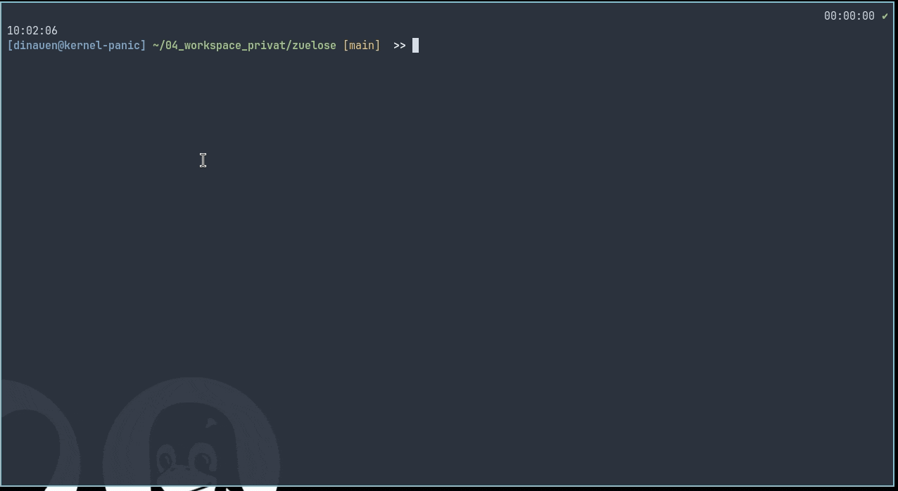

# zuelose

A minimalistic terminal radio and podcast player built with Go.



## Features

- **Radio**: search stations via [RadioBrowser](https://www.radio-browser.info), save favourites, and organise them into categories.
- **Podcasts**: search the iTunes directory, subscribe to feeds, browse new episodes, and resume playback.
- **Themes**: switch between dark and light themes (Tokyo Night, Nord, Gruvbox, Catppuccin, Rose Pine, Everforest, Solarized).
- **Playback**: powered by mpv; shows now-playing info, codec, bitrate, volume, and progress.
- **Keyboard-driven**: navigate, search, play, and manage everything from the keyboard.

## Runtime Requirements

- [mpv](https://mpv.io) installed and available as `mpv` (or configure a custom path in `~/.config/zuelose/config.yaml`)

## Building from source

- Go 1.26.11 or newer
- GNU Make
- Python 3.10 or newer for changelog tooling tests

```bash
make build   # creates the ./zuelose binary with version metadata
make test    # run Go and changelog tooling tests
make check   # build, test, and run go vet
make clean   # remove the binary
```

### Install

Install to `/usr/local/bin` by default:

```bash
sudo make install
```

For a user-local installation:

```bash
make install PREFIX="$HOME/.local"
```

`DESTDIR` is supported for staged package installs:

```bash
DESTDIR=/tmp/zuelose-package make install PREFIX=/usr/local
```

Remove an installed binary with:

```bash
make uninstall PREFIX="$HOME/.local"
```

### Version

```bash
./zuelose version
./zuelose --version
```

Release builds are stamped with their Git tag. Local builds use `git describe` and fall back to `dev` when no version is available. A specific version can be supplied explicitly:

```bash
make build VERSION=v1.2.3
```

## Run

Once built, only `mpv` is needed at runtime:

```bash
./zuelose    # run the built binary
```

Or build and run in one shot (requires both Go and mpv):

```bash
make run
```

## Releases

Tag pushes matching `v*` trigger the release workflow. It builds, tests, runs `go vet` and `govulncheck`, then publishes archives for:

- Linux amd64 and arm64
- macOS amd64 and arm64

Assets use the following naming scheme:

```text
zuelose_<version>_<os>_<arch>.tar.gz
SHA256SUMS
```

Verify a downloaded archive before extracting it:

```bash
sha256sum -c SHA256SUMS       # Linux
shasum -a 256 -c SHA256SUMS   # macOS
```

Release notes come from the matching version section in [CHANGELOG.md](CHANGELOG.md). Before tagging a release, move the relevant entries from `[Unreleased]` into a dated section such as `[1.2.3] - 2026-11-27`, then push the tag:

```bash
git tag v1.2.3
git push origin v1.2.3
```

The release workflow fails if the tag is invalid or its changelog section is missing or empty.

## Continuous integration

GitHub Actions builds and tests every push and pull request. Pull requests also run `govulncheck`. To run the same vulnerability scan locally:

```bash
go install golang.org/x/vuln/cmd/govulncheck@latest
make vulncheck
```

## Configuration

Config is stored in `~/.config/zuelose/config.yaml`:

```yaml
volume: 75
mpv_path: mpv
api_host: all.api.radio-browser.info
podcast_refresh_interval: 60
podcast_browser: itunes
theme: tokyo-night
theme_mode: dark
```

Favourites, subscriptions, and episode progress are saved automatically in the same directory.

## Keybindings

| Key | Action |
|-----|--------|
| `↑` / `↓` | Move up / down |
| `Tab` / `Shift+Tab` | Next / previous pane |
| `Enter` | Select / play |
| `Esc` | Back / cancel / leave input |
| `←` / `→` | Previous / next pane (when not typing) |
| `Space` | Pause / resume |
| `+` / `-` | Volume up / down |
| `q` / `Ctrl+c` | Quit |
| `?` | Help overlay |

Letter shortcuts are case-insensitive.

### Playback

These are shown in the now-playing pane when media is active:

| Key | Action |
|-----|--------|
| `Space` | Pause / resume (podcasts) |
| `Space` | Connect / disconnect (radio streams) |
| `Shift+←` / `Shift+→` | Seek ±10 s (podcasts) |
| `Shift+↑` / `Shift+↓` | Seek ±60 s (podcasts) |
| `+` / `-` | Volume up / down |

### Radio

| Key | Action |
|-----|--------|
| `/` | Focus search |
| `r` | Refresh results |
| `f` | Add to favourites |

### Favourites

| Key | Action |
|-----|--------|
| `f` | Edit favourite category |
| `d` | Remove favourite |
| `c` | Create category |

### Podcasts

| Key | Action |
|-----|--------|
| `/` | Focus podcast search |
| `Enter` | Preview / open / play |
| `a` | Subscribe / add feed |
| `d` | Delete subscription |
| `r` | Refresh |

In the podcast preview, `Enter` plays the selected episode, `a` subscribes, `/` returns to search, and `Esc` goes back to the search results.

### Settings

| Key | Action |
|-----|--------|
| `Enter` / `e` | Edit or cycle setting |
| `Esc` | Focus sidebar |

## Dependencies

- [Bubble Tea](https://github.com/charmbracelet/bubbletea) — TUI framework
- [Bubbles](https://github.com/charmbracelet/bubbles) — input components
- [Lipgloss](https://github.com/charmbracelet/lipgloss) — styling
- [gofeed](https://github.com/mmcdole/gofeed) — RSS/Atom parsing
- [mpv](https://mpv.io) — audio playback

